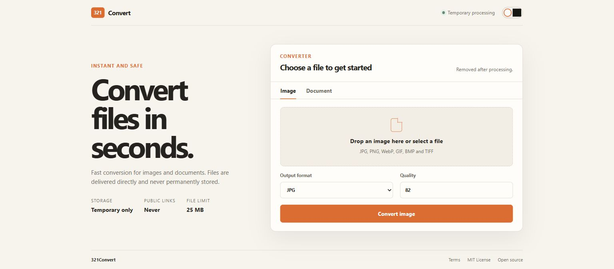
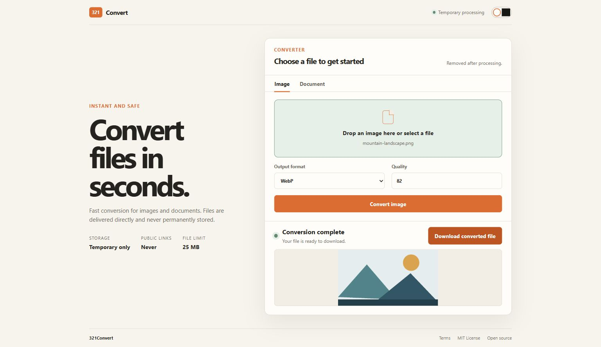
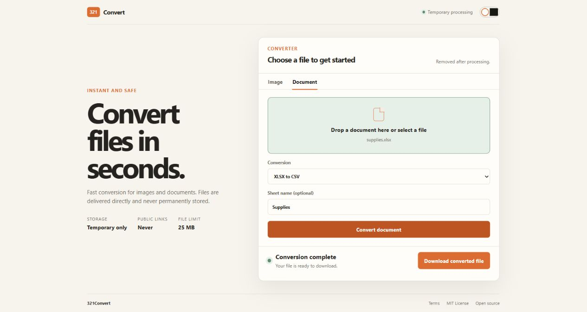
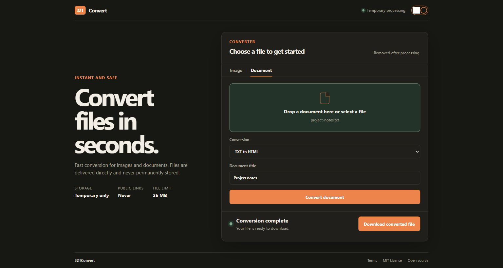
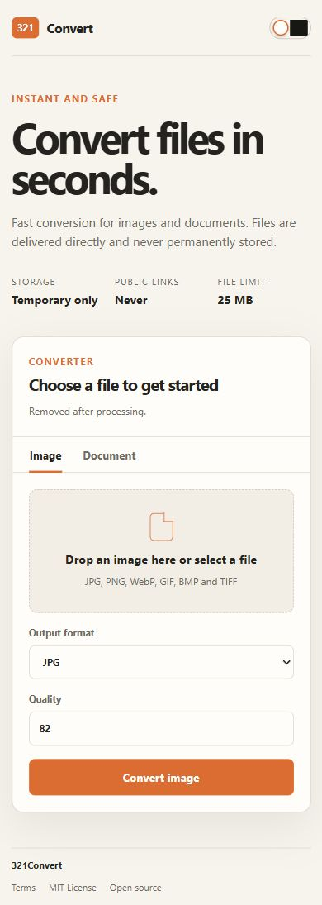
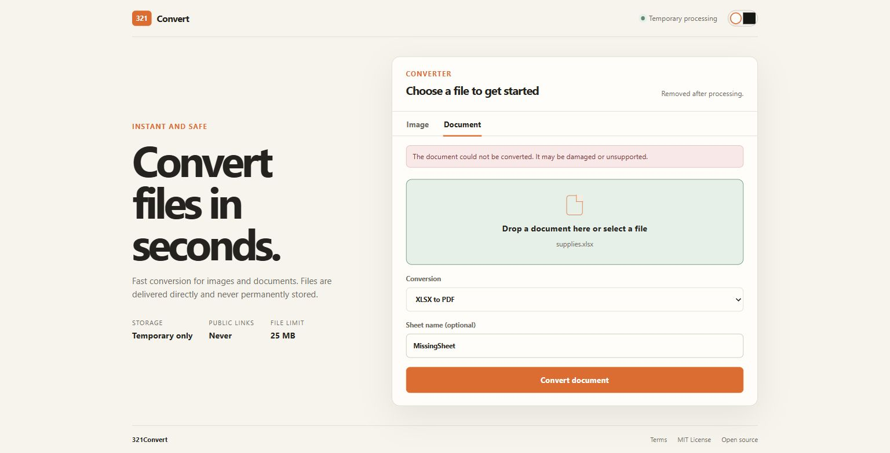

# 321Convert

My first deployed project: a Flask web app for converting images and documents, with temporary file processing and direct downloads.

**Live demo:** [three21convert.onrender.com](https://three21convert.onrender.com)

Maintained by [ChardXBT](https://github.com/ChardXBT).



Choose a file, select a conversion, and download the result. No account is required. The Image and Document tabs keep the two workflows on one page.

Render may need time to wake the service after inactivity. Wait for the converter to appear before uploading a file.

## Image conversion

Select a file or drag it into the upload area. Convert between JPG, PNG, WebP, GIF, BMP, and TIFF. The quality control accepts values from 1 to 100 and affects JPG and WebP output. Successful conversions show an image preview and a download button.



This example converts `mountain-landscape.png` to WebP. Image conversion uses the first frame of animated or multi-frame files. JPEG output places transparent areas on a white background.

## Document conversion

| Input | Output | What it does |
| --- | --- | --- |
| PDF | DOCX | Extracts selectable text into a Word document, grouped by page. It does not reproduce the original page layout or perform OCR. |
| XLSX | PDF | Turns a worksheet into a table in a PDF. |
| XLSX | CSV | Exports worksheet data as CSV. Formula-like text values are escaped to reduce spreadsheet formula injection. |
| HTML / HTM | PDF | Prints the HTML source as inert text. It does not render a webpage or fetch remote resources. |
| TXT | HTML | Escapes the text and adds a configurable document title. |

For XLSX conversions, enter an optional sheet name to choose a worksheet. Leave it blank to use the first sheet.



The `Supplies` worksheet is ready to download as CSV. Document results use the same download control as images, without an inline document preview.



The TXT workflow exposes a document title field. Here, `project-notes.txt` becomes an HTML document titled **Project notes**.

DOCX to PDF and OCR are intentionally not advertised because they require system software that is not available on a standard Render Python service.

## Mobile layout and interface details

The layout stacks vertically on narrow screens. The header switch changes between light and dark themes and remembers the selection in the browser. The footer opens Terms and MIT License dialogs and links to this repository.



During conversion, the submit button is disabled and a progress message appears. Failed requests show an inline error and allow another attempt. The deployed app displays a 25 MB request limit.

<details>
<summary>Example: conversion error feedback</summary>



An invalid sheet name produces a general conversion error. The selected file and controls remain available so the request can be corrected.

</details>

## Implementation

Flask serves a Jinja template and two conversion endpoints. Plain JavaScript submits files, displays status messages, and creates browser-local download links from the returned files. CSS provides the responsive layout and themes.

- **Images:** Pillow validates and converts the image data.
- **Spreadsheets:** pandas and openpyxl read worksheet data.
- **Documents:** pypdf extracts PDF text; python-docx and docxcompose build DOCX files; xhtml2pdf generates PDFs from escaped text or generated tables.
- **Deployment:** Render runs Gunicorn. The Blueprint uses Python 3.12.11 and checks `/health`.

## Privacy model

- Files are processed inside a unique operating-system temporary directory.
- Results are returned directly in the conversion request as private attachments.
- Temporary input and output files are deleted before the response is sent.
- There are no public download URLs, accounts, databases, analytics, or permanent uploads.

No hosted service can honestly promise to be "unhackable." This project reduces risk with strict conversion allowlists, bounded uploads and outputs, archive-bomb checks, image decompression-bomb protection, rate limiting, sanitized errors, security headers, and a strict Content Security Policy.

## Local setup

```powershell
py -3.12 -m venv .venv
.\.venv\Scripts\Activate.ps1
python -m pip install -r requirements.txt
python app.py
```

Open `http://127.0.0.1:5000`.

## Tests

```powershell
python -m unittest discover -v
python -m pip check
```

## Render deployment

The repository includes `render.yaml` and a hardened `Procfile`. Connect the public GitHub repository to Render and deploy the Blueprint. Do not add secrets: the app does not require any.

See [render.yaml](render.yaml), [Procfile](Procfile), and [requirements.txt](requirements.txt) for the deployment commands and Python dependencies.

Useful environment controls:

| Variable | Default | Purpose |
| --- | ---: | --- |
| `MAX_UPLOAD_BYTES` | 26214400 | Maximum request size |
| `MAX_OUTPUT_BYTES` | 78643200 | Maximum returned file size |
| `MAX_ARCHIVE_BYTES` | 104857600 | Maximum expanded Office archive size |
| `RATE_LIMIT_REQUESTS` | 20 | Requests allowed per window |
| `RATE_LIMIT_WINDOW` | 600 | Rate-limit window in seconds |
| `TRUST_PROXY` | false locally, true on Render | Trust one known proxy hop |

## License

MIT

## Legal

- [Terms of Service](TERMS.md)
- [MIT License](LICENSE)

Screenshots were captured from the deployed application on October 16, 2026, using synthetic example files. See the [capture notes](docs/screenshots/README.md) for coverage and verification details.
