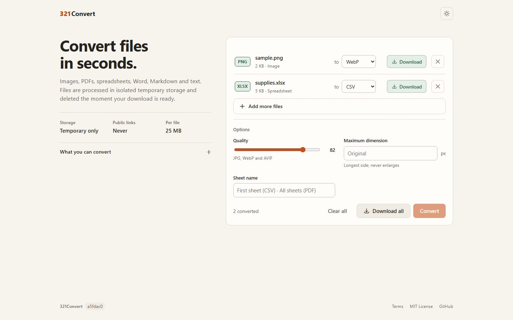

# 321Convert

A small, private file converter. Drop in images, PDFs, spreadsheets, Word documents,
Markdown, HTML or text; pick a target format; download the result. No accounts, no stored
files, no third-party services.

**Live:** [three21convert.onrender.com](https://three21convert.onrender.com) · Maintained by
[ChardXBT](https://github.com/ChardXBT) · MIT licensed



The free Render instance sleeps when idle, so the first request after a quiet period can
take up to a minute. After that, conversions are fast.

## What it converts

| Input | Formats | Output |
| --- | --- | --- |
| Image | JPG, PNG, WebP, GIF, BMP, TIFF, HEIC/HEIF, AVIF, ICO | JPG, PNG, WebP, GIF, BMP, TIFF, AVIF, ICO, PDF |
| PDF | PDF | DOCX, TXT, PNG, JPG |
| Spreadsheet | XLSX | CSV, PDF |
| CSV | CSV | XLSX |
| Word document | DOCX | PDF, TXT, HTML |
| HTML | HTML, HTM | PDF |
| Plain text | TXT | PDF, HTML |
| Markdown | MD, MARKDOWN | HTML, PDF |

Several files can be queued at once; each is converted in turn and downloaded individually.

### Images

- EXIF orientation is applied, then all other metadata (location, device) is dropped.
  Embedded colour profiles are kept when the output format supports them.
- Transparency is preserved for PNG, WebP, GIF, TIFF, AVIF and ICO; it is flattened onto
  white for JPG and PDF.
- Animated GIF/WebP and multi-page TIFF keep all frames when the output is GIF, WebP, TIFF or
  PDF (one page per frame); other outputs take the first frame.
- **Quality** (1–100) applies to JPG, WebP and AVIF. **Maximum dimension** shrinks the longest
  side to the given size and never enlarges.
- ICO output is capped at 256 × 256 and includes the standard sizes up to that limit.
- Image → PDF places each image on an A4 page, fitted inside a margin.

### Documents and spreadsheets

- **PDF → DOCX** extracts selectable text (one page per PDF page, with embedded images) — it
  does not reproduce the original layout and does not perform OCR. **PDF → TXT** extracts text
  only. **PDF → PNG/JPG** rasterises pages at 144 DPI; multi-page PDFs return a ZIP with one
  image per page. Password-protected PDFs are refused with a clear message.
- **XLSX → CSV** exports one worksheet (the first, or the one you name) as UTF-8 with BOM so
  Excel opens it correctly; dates become ISO 8601 and formula-looking text is escaped to
  prevent spreadsheet formula injection. **XLSX → PDF** renders every worksheet (or a named one)
  as a table. **CSV → XLSX** detects the delimiter, converts numeric fields to numbers and stores
  everything else as literal text.
- **DOCX → PDF/HTML/TXT** preserves headings, paragraphs, bold/italic/underline, lists, tables,
  hyperlinks, page breaks and embedded images. Layout is approximated, not reproduced.
- **HTML → PDF** renders a sanitised subset of HTML (text, headings, lists, tables, inline
  styles, embedded `data:` images). Scripts, external stylesheets and remote images are removed
  and nothing is fetched from the network.
- **Markdown → HTML/PDF** supports tables, fenced code and nested lists; raw HTML inside the
  Markdown is sanitised.
- Generated PDFs embed DejaVu Sans, so Latin, Greek, Cyrillic and most symbols render
  correctly. CJK text is not covered.

## Limits

| Limit | Default |
| --- | --- |
| Upload size | 25 MB per file |
| Image size | 40 megapixels; animations up to 300 frames / 120 megapixels in total |
| PDF | 300 pages for text extraction; the first 50 pages for rasterising |
| Spreadsheet | 500 000 cells; 2 000 rows per sheet in PDF output |
| HTML | 3 MB |
| Time | 90 seconds per conversion |
| Rate | 60 conversions per 10 minutes per client; 2 conversions at a time |

Over-limit requests fail fast with a plain-language error. Everything in the table is an
environment variable (see Deployment).

## Privacy and security

- Each request runs in its own temporary directory. The result is read into memory and the
  directory is deleted before the response is sent. There are no public download links,
  accounts, databases, analytics or persistent uploads.
- Every conversion runs in an isolated child process with a hard timeout. A crash, hang or
  memory blow-up in a parser kills that process only; the web server keeps serving.
- Uploads are validated by extension and content (PDF header, Office ZIP structure and
  size/path checks, text files must not contain NUL bytes, images must decode as one of the
  accepted formats). Decompression bombs are refused.
- HTML and Markdown input is sanitised with an allow-list, and the PDF renderer is locked to a
  read-only font directory with network access disabled.
- Responses carry a strict Content-Security-Policy (nonce-based for the single inline
  script), `frame-ancestors 'none'`, HSTS, `Referrer-Policy: no-referrer` and the usual
  hardening headers. POST requests must be same-origin; an in-memory per-IP rate limit and a
  concurrency cap protect the service.
- Error messages never include file names, file contents or parser internals; logs record only
  the conversion type, timing, sizes and exception class.

See [SECURITY.md](SECURITY.md) for how to report a vulnerability.

## HTTP API

The UI uses the same endpoints you can call directly.

```
GET  /api/formats            → JSON describing families, outputs and options
POST /api/convert            multipart/form-data: file=<upload> target=<ext> [quality] [max_dimension] [sheet_name] [title]
GET  /health                 → {"status": "ok", "version": "<git sha>"}
```

A successful `POST /api/convert` returns the converted file as an attachment with
`Content-Disposition` (UTF-8 filename) and an `X-Conversion-Notes` header holding a JSON list
of short notes such as `"Transparent areas were flattened to white."`. Errors are JSON:
`{"success": false, "error": "…"}` with status 400 (bad request), 413 (too large), 422
(could not convert), 429 (rate limited), 503 (busy) or 504 (timed out).

```sh
curl -F file=@photo.heic -F target=jpg -F quality=85 https://three21convert.onrender.com/api/convert -o photo.jpg
```

The original `POST /convert` and `POST /document/convert` routes still work as thin aliases.

## Local setup

```powershell
py -3.12 -m venv .venv
.\.venv\Scripts\Activate.ps1
python -m pip install -r requirements-dev.txt
python app.py
```

Open `http://127.0.0.1:5000`. On Windows each conversion spawns a fresh child process
(about a second); on Linux a pre-warmed fork server makes this negligible. Set
`CONVERSION_ISOLATION=inline` to run conversions in-process while debugging.

## Tests

```powershell
ruff check . ; ruff format --check .
pytest -q                 # unit, API and security tests (fast, in-process conversions)
playwright install chromium
pytest -m e2e -q          # browser tests against a live local server
python scripts/capture_screenshots.py [--base-url URL]   # refresh docs/screenshots
```

CI runs the same steps on Python 3.12 and 3.13 plus `pip-audit`; Dependabot keeps
dependencies current. The design is documented in [docs/ARCHITECTURE.md](docs/ARCHITECTURE.md).

## Deployment

[render.yaml](render.yaml) is a Render Blueprint: a single Python web service running Gunicorn
with a health check on `/health`. No secrets are required. Pushing to `master` deploys.

| Variable | Default | Purpose |
| --- | ---: | --- |
| `MAX_UPLOAD_BYTES` | 26214400 | Maximum request size |
| `MAX_OUTPUT_BYTES` | 78643200 | Maximum returned file size |
| `CONVERSION_TIMEOUT` | 90 | Seconds before a conversion is killed |
| `MAX_CONCURRENT_CONVERSIONS` | 2 | Conversions running at once |
| `RATE_LIMIT_REQUESTS` / `RATE_LIMIT_WINDOW` | 60 / 600 | Per-client rate limit |
| `MAX_IMAGE_PIXELS`, `MAX_FRAMES`, `MAX_PDF_PAGES`, `MAX_PDF_RENDER_PAGES`, `MAX_SPREADSHEET_CELLS`, `MAX_PDF_TABLE_ROWS`, `MAX_HTML_BYTES` | see `core/config.py` | Content limits |
| `CONVERSION_ISOLATION` | process | `process` or `inline` |
| `TRUST_PROXY` | false (true on Render) | Trust one proxy hop for client IPs |
| `LOG_LEVEL` | INFO | Logging verbosity |

## Known limitations

- No OCR: scanned PDFs convert to empty text with a note saying so.
- DOCX → PDF and HTML → PDF approximate layout; complex designs will not match Word or a browser.
- HEIC/HEIF is an input format only; CJK glyphs are not embedded in generated PDFs.
- The free Render tier has a cold start of up to a minute after inactivity.

## Legal

[Terms of Service](TERMS.md) · [MIT License](LICENSE) · [Code of Conduct](CODE_OF_CONDUCT.md)
